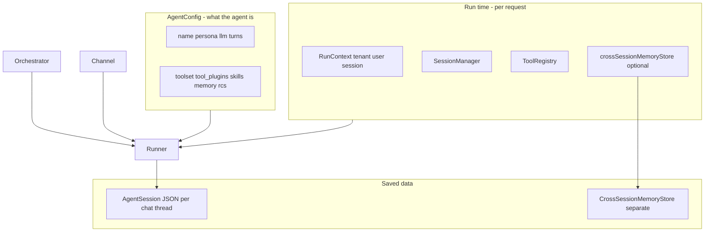
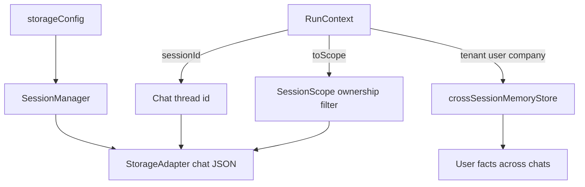
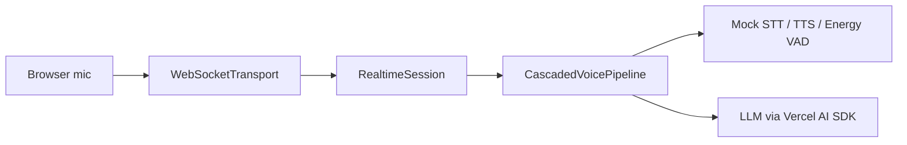

# Architecture: what goes where

**Who this is for:** Anyone wiring Nexus for the first time who needs to know which settings belong in which object.

## Key terms

- **Agent config** (`AgentConfig`) — Describes what the agent is: model, personality, turn limits, toolset, memory, summarization. Build with `parseAgentConfig()`.
- **Run context** (`RunContext`) — Describes this specific call: which customer, which user, which chat thread. Build with `createRunContext()`.
- **Runner** (`AgentRunner`) — Runs one agent. You pass config, tools, storage, and run context into it.
- **Orchestrator** (`AgentOrchestrator`) — Runs a team of agents in a pattern (supervisor, pipeline, or parallel).
- **Storage** — Wires where chat history JSON is saved: a `SessionStorageConfig` or a ready `SessionManager` (memory and file always; SQLite via `@libsql/client`).
- **Tool registry** — A catalog of tools the LLM can call. You register tools here before running.
- **Channel** — An I/O edge (Telegram, WhatsApp, WebSocket) that turns provider payloads into `UserInput` + `RunContext`.

## One rule

**Agent config = behavior.** **Run context + runner args = who, where, and which chat.**

Nexus splits “what the agent is” from “who is using it and where data lives”. This makes multi-tenant SaaS apps straightforward.

## Concern table

| Concern | Put it on | Notes |
|---------|-----------|-------|
| LLM, persona, turns, toolset, skills, memory, RCS, context summary | `AgentConfig` | Built once per agent template |
| Within-chat turn compression | `context_summary` on `AgentConfig` | Folds oldest turns into `summary_text` when context fill exceeds `summarize_on` |
| Within-chat tool output compression | `rcs` on `AgentConfig` | Summarizes large tool results in context |
| Tenant, user, chat id, extra metadata | `RunContext` | New per HTTP request or job |
| Chat history backend | `storageConfig` / `sessionManager` on the runner | Preferred in production |
| Chat history fallback | `AgentConfig.storage` | Only when runner has no `storageConfig` |
| Cross-chat user memory | `crossSessionMemoryStore` + `RunContext.userId` | Separate from session JSON |
| Voice STT / TTS / VAD | `RealtimeAgentConfig` | Client-side mock / energy adapters in this package |
| Messaging apps | `ChannelAdapter` + `ChannelRouter` | Normalize inbound to `UserInput` |

## Four objects people mix up

When you wire a multi-tenant SaaS app, four names sit next to each other on `AgentRunner`. They answer different questions.

| Object | Answers | Is it the chat thread? |
|--------|---------|------------------------|
| `RunContext` | Who is calling, which chat id, flags, metadata, services | Holds `sessionId` (the chat thread id) |
| `SessionScope` | Ownership **filter** for storage ops (`tenantId` / `companyId` / `userId`) | No — does not include `sessionId` |
| `storageConfig` | Where/how **chat history JSON** is saved | Config (`SessionStorageConfig`) or a ready `SessionManager` |
| `crossSessionMemoryStore` | Where **user facts** live across chat threads | Separate store — not chat JSON |

**Common mistakes:**

- `SessionScope` is **not** the chat session. The chat thread is `sessionId` on `RunContext` / `AgentSession`. Scope is only “whose rows may I touch?” when loading or listing.
- `SessionScope` is **not** “the SaaS user.” It is an optional filter on up to three identity fields. Products choose dimensions (for example tenant + company, or tenant + user).
- `storageConfig` is **not** the adapter. The adapter is `StorageAdapter`. The runner arg either describes which adapter to build or passes a ready `SessionManager` that already wraps one.
- `crossSessionMemoryStore` is **not** `SessionScope` and **not** chat history. It holds durable key/value facts keyed by tenant + user + namespace (optional company).

## Storage priority

1. `new AgentRunner({ storageConfig })` or `new AgentOrchestrator({ storageConfig })` — **wins**
2. Else `AgentConfig.storage` — fallback
3. Else in-memory — **not shared** across team members

## Chat thread id priority (single agent)

1. `run({ sessionId })` — override for this call only
2. Else `RunContext.sessionId`
3. Else auto-generated UUID

After resolution, the runner copies the chosen id back onto `RunContext`.

## Multi-agent teams

- Each team member gets its own chat history file (not one merged blob).
- Member chat ids look like `{groupChatId}_{memberName}` (for example `team-1_researcher`).
- In a **pipeline**, the next agent receives the previous agent’s final text reply as its input message.

**Important:** For teams, set `RunContext.sessionId` **before** you create the orchestrator or `OrchestrationRuntime`. Member chat ids are fixed at construction time.

## YAML orchestration vs TypeScript API

| Approach | Best when |
|----------|-----------|
| YAML manifest + `OrchestrationRuntime` | You want declarative config, env-based secrets, or ops-owned agent definitions |
| TypeScript `parseAgentConfig` + `AgentRunner` | You build config in code (factories per tenant/plan) |

Both paths use the same underlying types. See [getting-started.md](getting-started.md) and [getting-started-typescript.md](getting-started-typescript.md).

## Voice agents (RealtimeRuntime)

Text agents use `OrchestrationRuntime` or `AgentRunner`. Voice agents use `RealtimeRuntime`, which wraps the same `AgentConfig` with media settings (STT, TTS, VAD, duplex mode).

| Approach | Best when |
|----------|-----------|
| YAML + `RealtimeRuntime` (this package) | Client-side mocks: `stt/tts: { provider: mock }`, energy VAD |
| Python Voice Lab + gRPC `servers:` | Real GPU STT/TTS/LID — stays in the [Python package](https://github.com/gowrav-vishwakarma/nexus-enterprise-agent) |

**This package:** mock adapters so you can test without GPUs. **Python package:** `./scripts/run_voice_lab.sh` starts gRPC media servers and a browser UI. See [guides/voice-lab.md](guides/voice-lab.md) and [guides/model-servers.md](guides/model-servers.md).

## Least-privilege context

Give the model the smallest context that can still do the job (sometimes called ALARA: as low as reasonably achievable).

| Layer | Pattern in Nexus |
|-------|------------------|
| Skill catalog | Names and one-line descriptions in the system prompt |
| Skill body | Full `SKILL.md` only after `skills.load_skill` |
| Skill section | One `##` heading via `skills.load_skill(..., section="security")` |
| Tools | Narrow `toolset` packs; do not grant `sh` / `python` by default |
| Delegation | `deriveChild` so a subagent does not inherit the parent’s whole tool list |
| Regulated files | Fixed paths and allow-lists, not an open filesystem |

Do not dump every skill, every tool, and every document into the first turn. Load on demand. See [tools.md](reference/tools.md) and [guides/skills-storage.md](guides/skills-storage.md).

## Related guides

- [Pipelines](guides/pipelines.md) — which pipeline to run (text, voice, teams)
- [Runtime control](guides/runtime-control.md) — take charge when tools or tenant state change

## Next steps

- [Getting started (YAML)](getting-started.md)
- [Getting started (TypeScript)](getting-started-typescript.md)
- [SaaS example](guides/saas-example.md)
- [Custom storage adapter](guides/custom-storage-adapter.md)
