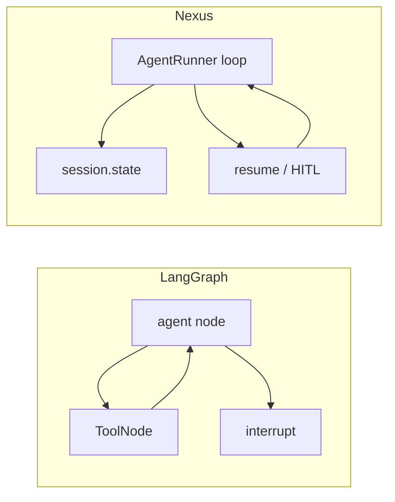
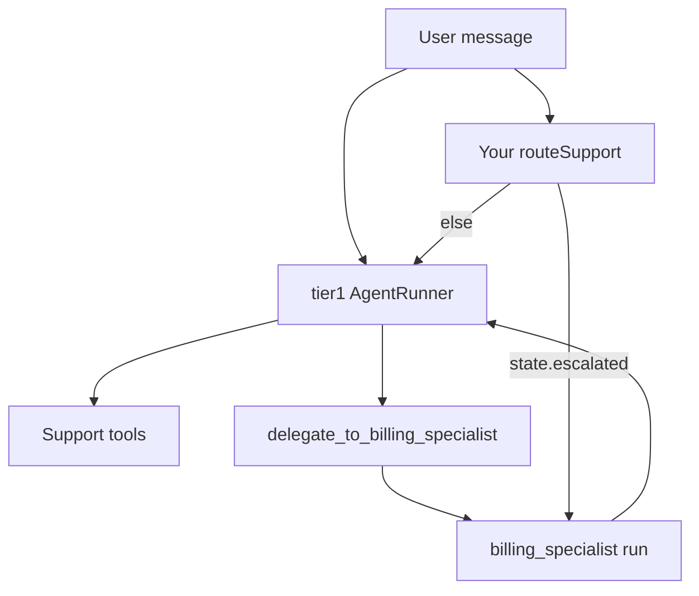

# Porting from LangGraph

**Who this is for:** Developers who built a stateful agent with [LangGraph](https://langchain-ai.github.io/langgraph/) and want the same behaviour on Nexus without adding LangGraph as a dependency.

## Key terms

- **StateGraph** — LangGraph object that wires nodes and edges; state is a typed dict (often `messages` plus custom fields).
- **Checkpointer** — LangGraph store (for example `MemorySaver`, `SqliteSaver`) that saves graph state per `thread_id`.
- **Conditional edge** — Route to the next node based on state or tool output.
- **Interrupt** — Pause the graph for human approval, then resume.
- **Checkpoint state** — In Nexus, `RunContext.state` synced to `AgentSession.state` when storage persists.
- **Chat thread** — Nexus `sessionId` (same role as LangGraph `thread_id`).

## Why this guide exists

Nexus targets production SaaS: tenants, storage adapters, voice, and multi-agent teams. This page ports **one complex LangGraph app** to Nexus so you can map concepts directly.

LangGraph is **not installed** in this repository. Section 1 is illustrative pseudocode. Section 2 and 3 are Nexus TypeScript (mock or real LLM).

## The scenario

A **tier-1 support agent** that:

1. Keeps structured state: `customer_id`, `plan_tier`, `escalated`.
2. Runs a ReAct loop (LLM → tools → LLM).
3. Routes to escalation when a tool signals it.
4. Pauses for **human approval** before issuing a refund.
5. Can hand off to a **billing specialist** (sub-agent).
6. Persists state across messages on the same thread.



---

## Section 1: LangGraph version (illustrative only)

> Not runnable here — `langgraph` is not a dependency of Nexus.

```python
# Illustrative LangGraph — do not run in this repo.
from typing import Annotated, TypedDict
from langgraph.graph import StateGraph, END
from langgraph.checkpoint.sqlite import SqliteSaver

class SupportState(TypedDict):
    messages: Annotated[list, add_messages]
    customer_id: str
    plan_tier: str
    escalated: bool

def should_escalate(state: SupportState) -> str:
    if state["escalated"]:
        return "human"
    return "agent"

builder = StateGraph(SupportState)
builder.add_node("agent", agent_node)
builder.add_conditional_edges("agent", should_escalate, {"agent": "tools", "human": "human"})
checkpointer = SqliteSaver.from_conn_string("support.db")
graph = builder.compile(checkpointer=checkpointer, interrupt_before=["human"])

config = {"configurable": {"thread_id": "cust-42"}}
graph.invoke({"messages": [("user", "Refund my last charge")]}, config)
```

---

## Section 2: Nexus port (TypeScript API)

Same scenario with Nexus primitives: checkpoint `state`, storage adapter, client-tool pause, optional supervisor team.

### Tools

```ts
import { defineTool, type RunContext } from "nexus-enterprise-agent";

const fetchAccount = defineTool((ctx: RunContext, customer_id: string) => {
  ctx.setState("customer_id", customer_id);
  const tier = String(ctx.get("plan_tier") ?? "standard");
  ctx.setState("plan_tier", tier);
  return `Account ${customer_id} plan=${tier}`;
}, { name: "fetch_account" });

const issueRefund = defineTool((_ctx: RunContext, amount: number) => "", {
  name: "issue_refund",
  execution: "client",
  description: "Request human approval in the UI",
});

const markEscalate = defineTool((ctx: RunContext, reason: string) => {
  ctx.setState("escalated", true);
  ctx.setState("escalate_reason", reason);
  return "STATUS: escalate";
}, { name: "mark_escalate" });
```

Use `ctx.setState` for fields that must exist on the **next** HTTP request. Use `ctx.set` / `ctx.get` on `metadata` only for per-request data.

### Agent and storage

```ts
import {
  AgentRunner,
  createRunContext,
  parseAgentConfig,
  ToolRegistry,
  type TurnContext,
  type TurnDecision,
} from "nexus-enterprise-agent";

async function onTurnEnd(ctx: TurnContext): Promise<TurnDecision | null> {
  if (ctx.state.escalated && !ctx.state.refund_approved) {
    return { action: "inject", message: "Summarize case for human reviewer." };
  }
  return null;
}

function buildRunner(tenantId: string, plan: string): AgentRunner {
  const registry = new ToolRegistry();
  registry.addToolset("support", [fetchAccount, issueRefund, markEscalate]);

  const config = parseAgentConfig({
    name: "tier1_support",
    llm: { provider: "openai", model: "gpt-4o", api_key: "sk-..." },
    turns: { max_turns: 8, human_in_loop_after_turns: null },
    toolset: "support",
  });

  return new AgentRunner({
    config,
    toolRegistry: registry,
    storageConfig: {
      adapter: "sqlite",
      adapter_config: { data_root: "./data" },
    },
    runContext: createRunContext({
      tenantId,
      userId: "user-1",
      sessionId: "support-thread-1",
      metadata: { plan_tier: plan },
    }),
    onTurnEnd,
  });
}

const runner = buildRunner("acme", "pro");
let result = await runner.run({
  userMessage: "Refund my last charge",
  initialContext: { customer_id: "cust-42" },
});
if (result.status === "paused") {
  result = await runner.resume(result.sessionId, [
    { tc_id: "TC2", content: "Approved: refund $50" },
  ]);
}
console.log(result.finalResponse);
console.log(result.state);
```

### Streaming (typical SaaS path)

```ts
for await (const event of runner.runStream({
  userMessage: "Where is my invoice?",
  initialContext: { customer_id: "cust-42" },
})) {
  if (event.eventType === "paused") {
    // show approval UI
  }
  if (event.eventType === "final_response") {
    // event.data includes state
  }
}
```

### Concept mapping

| LangGraph | Nexus |
|-----------|--------|
| `StateGraph` + typed state | Chat history (automatic) + `ctx.state` |
| `ToolNode` loop | Built-in ReAct loop in `AgentRunner` |
| `add_conditional_edges` | Tool return strings + persona, `onTurnEnd`, or `runStream` supervision |
| `interrupt()` | `defineTool(..., { execution: "client" })` + `resume()`, or `human_in_loop_after_turns` |
| `SqliteSaver` / checkpointer | `storageConfig: { adapter: "sqlite" }` + `session.state` |
| `thread_id` | `createRunContext({ sessionId })` |
| Subgraph / specialist | `pattern: supervisor` + `delegate_to_*` |
| User facts across threads | `crossSessionMemoryStore` + `userId` |

### Redirecting to another agent (three patterns)

Section 2 above is **one** `AgentRunner` (tier-1 only). Scenario item 5 (“hand off to billing”) maps to one of these:

| Approach | Who decides | When to use |
|----------|-------------|-------------|
| **Supervisor + `delegate_to_*`** | The lead LLM calls a delegate tool | Dynamic handoff (“this looks like billing”) |
| **App/router in TypeScript** | Your code reads `result.state` or `onTurnEnd` | Fixed rules (“if `escalated`, run billing runner”) |
| **Pipeline** | Fixed member order in YAML | Always tier-1 → billing, not conditional |

#### 1. LLM-driven redirect (supervisor team)

With `pattern: supervisor`, Nexus picks a **lead** agent (first member named `supervisor`, else **first member in `members`**). For each other member it registers a tool on the shared registry:

- `supervisor.delegate_to_billing_specialist(task_input)` → runs that member’s `AgentRunner` and returns its `finalResponse` to the lead.

The orchestrator **auto-grants** `delegate_to_*` to the lead even when the lead uses a narrow `toolset`.

Example prompt line in `tier1_system`:

```text
When the user needs deep billing lookup (invoices, charges, tax lines), call
delegate_to_billing_specialist with the customer id and question. Otherwise use support tools yourself.
```

#### 2. Deterministic redirect (your application)

When routing must not depend on the model, branch **outside** the loop:

```ts
async function routeSupport(userMessage: string, sessionId: string) {
  const manager = tier1Runner.sessionManager;
  const sess = await manager.loadSession(sessionId, {
    scope: tier1Runner.runContext.toScope(),
  });
  const state = sess?.state ?? {};

  if (state.route === "billing" || state.escalated) {
    return billingRunner.run({ userMessage, sessionId: `${sessionId}_billing` });
  }

  const result = await tier1Runner.run({ userMessage, sessionId });
  if (result.state?.needs_billing) {
    return billingRunner.run({
      userMessage,
      sessionId: `${sessionId}_billing`,
      initialContext: { ...result.state },
    });
  }
  return result;
}
```

`onTurnEnd` can set flags (`ctx.state.needs_billing = true`) or return `{ action: "stop" }` so the app runs a **different** runner on the next line — it does not invoke another agent by itself.

#### 3. Logic-based **tool** choice (still one agent)

```ts
function buildRegistry(plan: string): ToolRegistry {
  const registry = new ToolRegistry();
  registry.addToolset("support", [fetchAccount, markEscalate]);
  if (plan === "pro") {
    registry.addToolset("support", [issueRefund]);
  }
  return registry;
}
```

Or per request: `runner.grantToolset("billing")` before `run()`. The LLM still chooses which tool to call; you control the **menu**, not the graph edge.

#### 4. Fixed handoff (pipeline, not conditional)

```yaml
groups:
  billing_flow:
    pattern: pipeline
    members: [tier1, billing_specialist]
```

Analyst always runs after tier-1 with tier-1’s final text as input — no “if billing then” branch.



---

## Section 3: YAML manifest (supervisor + billing)

Declarative team: a **lead** tier-1 agent delegates to `billing_specialist` via auto-generated `delegate_to_billing_specialist` tools. Put the lead **first** in `members`, or name an agent `supervisor`.

Tools are registered in TypeScript on a `ToolRegistry` passed to `OrchestrationRuntime.fromManifest()`.

```yaml
version: "1"
prompts_module: ./support_team_prompts.ts
root: support_team

defaults:
  llm: &llm
    provider: openai
    model: ${ENV:OPENAI_MODEL|gpt-4o}
    api_key: ${ENV:OPENAI_API_KEY|mock-key}

storage:
  adapter: sqlite
  adapter_config:
    data_root: ${ENV:NEXUS_DATA_ROOT|./data}

agents:
  tier1:
    llm: *llm
    tool_plugins: []
    persona:
      role: Tier-1 support lead
      goal: Resolve or delegate billing issues
      prompt: tier1_system

  billing_specialist:
    llm: *llm
    toolset: billing
    persona:
      role: Billing specialist
      goal: Deep billing lookups
      prompt: billing_system

groups:
  support_team:
    pattern: supervisor
    members: [tier1, billing_specialist]
```

Run:

```ts
import { OrchestrationManifest, OrchestrationRuntime, createRunContext } from "nexus-enterprise-agent";

const manifest = await OrchestrationManifest.load("support_team.yaml");
const runtime = await OrchestrationRuntime.fromManifest(manifest, {
  runContext: createRunContext({ tenantId: "acme", userId: "u-1", sessionId: "chat-1" }),
  toolRegistry: buildSupportRegistry(),
});
const result = await runtime.run({ userMessage: "I was double charged" });
```

Member chat ids are `{sessionId}_{memberName}`; checkpoint `state` is **per member session**. Copy shared fields with `initialContext` or `ctx.setState` in tools on a shared `RunContext` if both agents need the same `customer_id`.

---

## Section 4: Porting checklist

1. **List state fields** — Put durable fields in `ctx.state`; keep voice/IVR transients in `metadata` only.
2. **Map nodes** — One ReAct agent per role, or a supervisor group for specialists.
3. **Map tool loop** — Delete custom ToolNode; use `AgentRunner.run`.
4. **Map conditional edges** — Prefer explicit tool status strings; use `onTurnEnd` when routing must be deterministic in TypeScript.
5. **Map interrupt** — Client tools + `resume()`, or `turns.human_in_loop_after_turns`, or a new user message on the same `sessionId`.
6. **Map checkpointer** — Pick a storage adapter; pass a stable `sessionId` per chat thread.
7. **Map subgraphs** — `groups.pattern: supervisor` with `delegate_to_{member}` tools.
8. **Tenancy** — Set `tenantId`, `userId`, and optional `PersistenceResolver` ([saas-example.md](saas-example.md)).

---

## Section 5: What you gain / what to watch

**Gain:** Multi-tenant identity, per-plan config factories, the same tools on text and (client-side) voice pipelines, and production storage without wrapping LangGraph.

**Watch:**

- YAML manifests do not declare conditional edges; use TypeScript (`onTurnEnd`) or LLM routing.
- `NexusEventEmitter` sinks observe only — they cannot pause the loop (unlike `onTurnEnd`).
- `stop_on_result_type` and `stop_sequences` are not enforced in the runner yet ([runtime-control.md](runtime-control.md)).
- GPU Voice Lab stays in the [Python package](https://github.com/gowrav-vishwakarma/nexus-enterprise-agent).

---

## Next steps

- [Runtime control](runtime-control.md) — layers of control beyond the default loop
- [Pipelines](pipelines.md) — text, voice, teams
- [Agent runner](../reference/agent-runner.md)
- [SaaS example](saas-example.md) — call the library from any HTTP framework
