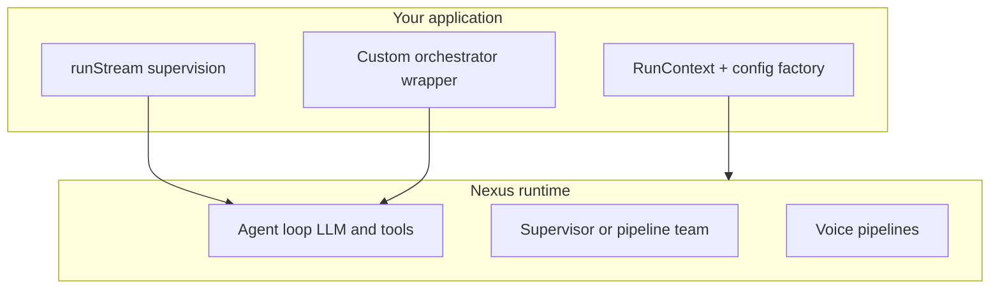

# Runtime control: take charge without a state graph

**Who this is for:** Developers who need deterministic control when a tool returns a specific value, tenant state changes, or they want LangGraph-style branching without building an explicit graph in Nexus.

## Key terms

- **Run context** — Per-request identity: tenant, user, chat thread, and a `metadata` bag your tools can read and write.
- **Supervision** — Your application code watches the agent loop (via streaming or events) and decides what to do next.
- **External human-in-the-loop (HITL)** — Stop the run, show a UI, then resume on the same chat thread with a new user message.
- **Pattern** — Multi-agent coordination style (`supervisor`, `pipeline`, `parallel`) — see [pipelines.md](pipelines.md).

## What Nexus does and does not do

Nexus is built for **SaaS-native dynamic assembly**: different tenants get different configs, tools, and storage **per request**. Inside a run, the default loop is **LLM-driven** (the model picks the next tool or reply based on context).

Nexus does **not** ship LangGraph-style **declarative conditional edges in YAML**. You **can** take control in TypeScript: checkpoint `state`, `onTurnEnd`, client-tool pause/resume, `cancel()`, `grantTools()`, and supervisor teams are supported today.

Nexus **does** support mid-loop pause for **client tools** and elicitations via `AgentRunner.resume()`.



For which pipeline to run, see [pipelines.md](pipelines.md).

---

## Layer 1: Per-request control (before the run starts)

Use this when behavior depends on **who** is calling, not on mid-run tool output.

### RunContext

Build one `RunContext` per HTTP request or job:

```ts
import { createRunContext } from "nexus-enterprise-agent";

const ctx = createRunContext({
  tenantId: "acme",
  userId: "user-42",
  sessionId: "chat-1",
  metadata: { plan_tier: "pro", locale: "en-IN" },
});
```

Tools with a parameter named `ctx` or `run_context` receive it automatically (stripped from the LLM schema).

### Per-tenant config factory

Different plans or tenants get different `AgentConfig` — tools, prompts, `max_turns`:

```ts
function buildRunner(tenantId: string, plan: string): AgentRunner {
  const config = buildConfigForPlan(plan);
  const registry = registryForPlan(plan);
  const ctx = createRunContext({ tenantId, metadata: { plan_tier: plan } });
  return new AgentRunner({ config, toolRegistry: registry, runContext: ctx });
}
```

**Worked example:** [saas-example.md](saas-example.md).

### Per-tenant storage

`PersistenceResolver` picks where chat history is saved per tenant. See [persistence-resolver.md](persistence-resolver.md).

### Dynamic prompts

Nunjucks prompt templates can read `tenant_id` / `tenantId`, `metadata`, and memory at render time. See [prompts-jinja.md](prompts-jinja.md).

**Important:** `OrchestrationRuntime` is built once at construction. To change config mid-run, build a **new** runtime for the next request.

---

## Layer 2: State that survives across turns

Use this when tools need shared state within one chat thread **and on the next HTTP request** for the same `sessionId`.

### Checkpoint state (`RunContext.state`)

Durable fields live in `RunContext.state`. Tools use `ctx.setState()` / `ctx.getState()`. The runner hydrates state from `AgentSession.state` at run start, syncs back after each turn when `shouldPersist` is true, and returns the final dict on `AgentRunResult.state`. Prompt templates can read `state`.

```ts
const escalate = defineTool((ctx: RunContext) => {
  ctx.setState("escalated", true);
  return "STATUS: escalate";
}, { name: "escalate" });
```

Configure file or SQLite storage so checkpoint state survives process restarts.

### initialContext

Seed metadata and checkpoint state once at run start (works on `run()` and `runStream()`):

```ts
const result = await runner.run({
  userMessage: "Start onboarding",
  sessionId: "chat-1",
  initialContext: { step: "welcome", account_id: "acc-99" },
});
```

`initialContext` still updates `session.metadata` as before.

### RunContext.metadata (read and write)

Per-request only — not checkpointed. Use for data that must not be saved (voice transients, one-call flags):

```ts
const reserveSlot = defineTool((ctx: RunContext, slot_id: string) => {
  ctx.set("reserved_slot", slot_id);
  return `Reserved ${slot_id}`;
}, { name: "reserve_slot" });

const confirmBooking = defineTool((ctx: RunContext) => {
  const slot = ctx.get("reserved_slot");
  if (!slot) return "ERROR: no slot reserved";
  return `Confirmed ${slot}`;
}, { name: "confirm_booking" });
```

The LLM still chooses when to call each tool. **`metadata` is for the same request**; use **`state`** when the next message must see the value.

### Turn-end hook (`onTurnEnd`)

For deterministic branching (LangGraph-style conditional edges), pass `onTurnEnd` to `AgentRunner`. Return `{ action: "stop" }` or `{ action: "inject", message: "..." }`. See [porting-from-langgraph.md](porting-from-langgraph.md).

### RCS context updates

When RCS is enabled, the LLM can pass `_context_updates` on tool calls to compress prior tool results.

---

## Layer 3: Branching after a tool returns

### Option A — Let the LLM decide (default)

Tool results are appended to chat context. The LLM reads them on the next turn and picks the next tool or final reply. Encode clear return strings:

```ts
const checkBalance = defineTool((ctx: RunContext) => {
  const balance = fetchBalance(ctx.tenantId);
  if (balance < 0) return "STATUS: escalate reason=negative_balance";
  return `STATUS: ok balance=${balance}`;
}, { name: "check_balance" });
```

Teach the persona to act on `STATUS: escalate` in the system prompt.

### Option B — Multi-agent routing

| Pattern | Control style | Doc |
|---------|---------------|-----|
| `supervisor` | LLM picks `delegate_to_{member}` | [pipelines.md](pipelines.md) |
| `pipeline` | Fixed member order; deterministic handoff | [pipelines.md](pipelines.md) |
| `parallel` | All members on same input; merge outputs | [pipelines.md](pipelines.md) |

### Option C — Supervise with runStream (your app branches)

Watch `tool_result` events and stop or reroute in application code:

```ts
let escalated = false;
for await (const event of runner.runStream(userMsg)) {
  if (event.eventType === "tool_result" && (event.content ?? "").includes("escalate")) {
    escalated = true;
    runner.cancel();
    break;
  }
  if (event.eventType === "final_response") {
    result = event.data;
  }
}

if (escalated) {
  await notifyHumanQueue(sessionId);
}
```

`AgentStreamEvent` types: `content`, `reasoning`, `tool_call`, `tool_result`, `client_tool_call`, `elicitation`, `paused`, `final_response`, `error`, `event`.

### Option D — Wrap the runner (full TypeScript control)

Run one or more turns yourself, inspect `AgentRunResult`, branch in TypeScript:

```ts
let result = await runner.run("Look up order 12345");
if ((result.finalResponse ?? "").includes("not_found")) {
  result = await runner.run({
    userMessage: "Order not found. Ask the user for their email.",
    sessionId: result.sessionId,
  });
}
```

Stronger control than LLM routing; more code on your side.

### Option E — Channels: fresh executor per message

`ChannelRouter` accepts `executorFactory: (ctx) => executor`. Each inbound message can build a new runner from current tenant state:

```ts
const router = new ChannelRouter(adapter, (ctx) => buildRunnerForTenant(ctx.tenantId ?? ""));
```

---

## Layer 4: Observability hooks (react, not pause)

Pass `eventEmitter` to `AgentRunner` or `OrchestrationRuntime`.

```ts
import { NexusEventEmitter, NexusEventType } from "nexus-enterprise-agent";

const emitter = new NexusEventEmitter();
emitter.registerSink({
  async emit(event) {
    if (event.eventType === NexusEventType.TOOL_CALL_COMPLETED) {
      console.log("tool done:", event.data);
    }
  },
});
const runner = new AgentRunner({ config, toolRegistry: registry, eventEmitter: emitter });
```

Event types include `tool_call.started`, `tool_call.completed`, `turn.completed`, `agent.completed`, and more.

**Note:** Callbacks observe the run; they do not pause the loop. Combine with `runStream` + `cancel()` if you need to stop early.

---

## Layer 5: Pause and resume (client tools)

<a id="pause-and-resume-client-tools"></a>

Use this when the **browser or mobile app** must run a tool, or when the model asks the user a structured question.

### Mark a tool as client-side

```ts
const pickFile = defineTool((prompt: string) => "", {
  name: "pick_file",
  execution: "client",
  description: "Ask the user to pick a file",
});
```

Tools whose name ends with `request_user_input` are treated as **elicitations** (same pause path, `eventType: "elicitation"`).

### Stream events

| Event | Meaning |
|-------|---------|
| `client_tool_call` | Client tool requested; `data` has `tc_id`, `call_id`, `tool_name`, `tool_args` |
| `elicitation` | User-input tool requested |
| `paused` | Loop stopped; `data.pending_interactions` lists what to fulfill |

Blocking `run()` returns `AgentRunResult` with `status: "paused"` and the same `pendingInteractions`.

### Resume API

```ts
const result = await runner.resume(sessionId, [
  { tc_id: "TC1", content: "user picked report.pdf" },
  // or match by provider id:
  // { call_id: "call_abc", content: "..." },
]);
```

| Name | Required? | Default | What it does |
|------|-----------|---------|--------------|
| `sessionId` | Yes | — | Chat thread that was paused |
| `results` | Yes | — | List of `{ tc_id \| call_id, content }` |
| `stream` | No | `false` | Passed through to the continued `run()` |

The runner fills empty tool responses, clears `pendingInteractions`, saves (if `shouldPersist`), and continues the loop.

---

## Layer 6: Cancel, grant tools, HITL

### cancel()

`runner.cancel()` cooperatively stops an in-flight `run()` / `runStream()`. The run ends with `status: "interrupted"`.

```ts
const pending = runner.runStream("Long research task");
setTimeout(() => runner.cancel(), 5_000);
for await (const event of pending) {
  if (event.eventType === "error" && event.data?.cancelled) break;
}
```

### grantTools / grantToolset / revokeTools

Toggle the tool menu **after** the runner exists (plan upgrade mid-session, feature flag):

```ts
runner.grantToolset("billing");
runner.grantTools(["issue_refund"]);
runner.revokeTools(["issue_refund"]);
```

`grantTools` also records names so the next `resolveToolset()` keeps them. The LLM still chooses which tool to call; you control the **menu**.

### External human-in-the-loop (HITL)

**Built-in:** Set `turns.human_in_loop_after_turns` on `AgentConfig` to pause after N completed turns. The run returns `status: "paused"` with a `human_in_loop` pending interaction; call `resume()` with the operator's text.

**Client tools:** `defineTool(..., { execution: "client" })` + `resume()` when the browser must run the tool.

**External operator (no pause API):** For approval that is not a client tool:

1. Run until `final_response` or your supervision breaks the stream.
2. Chat history is already saved (if storage is configured and `shouldPersist`).
3. Show UI to the human operator.
4. Resume with a new `userMessage` on the **same** `sessionId`:

```ts
const result = await runner.run({
  userMessage: "Approved: refund $50 to customer",
  sessionId: existingSessionId,
});
```

Prefer Layer 5 (`execution: "client"` + `resume()`) when the UI itself must execute the tool.

---

## LangGraph mapping (mental model)

For a full worked port (support agent with escalation, HITL, and a billing specialist), see [porting-from-langgraph.md](porting-from-langgraph.md).

| LangGraph idea | Nexus equivalent today |
|----------------|------------------------|
| Graph state | Chat history + `RunContext.state` / `AgentSession.state` |
| Conditional edge after node | LLM routing, `onTurnEnd` hook, or `runStream` supervision |
| Human interrupt node | Client tools + `resume()`, `human_in_loop_after_turns`, or external HITL |
| Checkpointer | Storage adapter + `sessionId` |
| Fixed sequence | `pattern: pipeline` |
| Dynamic delegation | `pattern: supervisor` + `delegate_to_*` |
| Observe every step | `runStream()` + `NexusEventEmitter` (observe only) |

---

## Config fields that look like control but are not wired yet

| Field | Status |
|-------|--------|
| `stop_on_result_type` | Not checked in runner loop |
| `stop_sequences` | Not checked in runner loop |
| `requiresApproval` on `defineTool` | Metadata only — no gate |

---

## Scenario cheat sheet

| Scenario | Recommended approach |
|----------|---------------------|
| Gate tools by SaaS plan | Config factory + `AgentConfig.toolset` pointing at plan-tier toolsets |
| Toggle capability packs per chat | Registry `addToolset()` + `toolset` per request, or `runner.grantToolset()` / `runner.revokeTools()` |
| Share data between tools in one run | `ctx.set()` / `ctx.get()` on `RunContext` |
| Browser must pick a file / show a form | `defineTool(..., { execution: "client" })` + `resume()` |
| Escalate to human on tool signal | `runStream` + `cancel()` on `tool_result` |
| Fixed research → write → review | `pattern: pipeline` in manifest |
| Dynamic specialist routing | `pattern: supervisor` |
| Deterministic TypeScript workflow | Wrap `AgentRunner` or pipeline pattern |
| Cron job must not save chat | `createRunContext({ isCron: true })` |
| Stop a runaway loop | `runner.cancel()` |
| Voice: user interrupts agent | `duplex: full` cascaded pipeline (Python GPUs or TS mocks) |

## Next steps

- [Pipelines guide](pipelines.md) — choose STT→LLM→TTS, S2S, teams, channels
- [Architecture](../architecture.md) — config vs run-time split
- [Porting from LangGraph](porting-from-langgraph.md)
- [SaaS example](saas-example.md)
